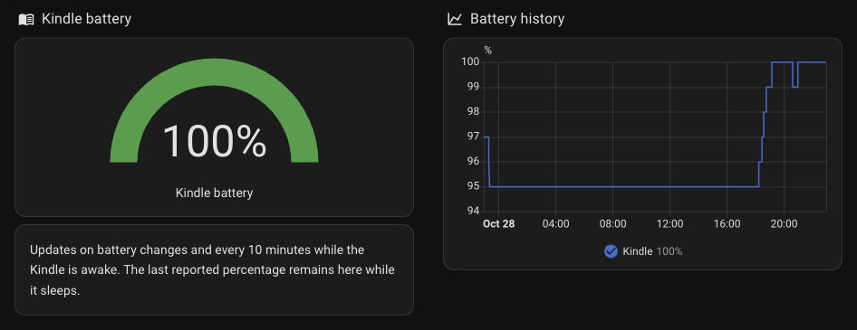

# Kindle battery monitor

Report a Kindle's battery percentage to Home Assistant using unencrypted [BTHome v2](https://bthome.io/) Bluetooth LE advertisements.

**Requires a modded (jailbroken) Kindle with KUAL installed.** This project is a KUAL extension: you use its KUAL menu to install the monitor, manage startup, check status, and uninstall it.

Samples are taken at startup, on battery-change events, and every ten minutes while awake. Each broadcast uses a five-second timer followed by bounded radio cleanup. The monitor permits normal suspend.

The fixed advertised name is `Kindle`. Home Assistant adds an address suffix, for example `Kindle ABCD`. The name is independent of Kindle Settings. Owned bursts use the factory public Bluetooth address so receivers recognize one device across radio restarts. Nearby receivers can read the percentage and address.

## Supported device

The qualified target is a jailbroken Paperwhite 4 on firmware 5.16.5, with KUAL and working stock Bluetooth services. The installer checks the exact model/build and refuses other targets before changing startup files. See [compatibility](docs/compatibility.md).

## Before installing

- Complete the jailbreak and its required post-jailbreak setup. The [Kindle Modding Wiki's getting-started guide](https://kindlemodding.org/jailbreaking/) explains the process and links to its jailbreak wizard. Availability depends on your Kindle model and firmware.
- Install KUAL and confirm you can open it from the Kindle library. KUAL is the launcher for this extension; copying the monitor ZIP onto an unmodified Kindle will not install it.
- Have Home Assistant set up with a working Bluetooth receiver and the BTHome integration.

The wiki's current [post-jailbreak guide](https://kindlemodding.org/jailbreaking/whats-next/) describes KPM and scriptlets for newer jailbreak setups. This project's distribution is a KUAL extension and has no KPM package or scriptlet installer. The wiki's [migration notes](https://kindlemodding.org/jailbreaking/faq/migration.html) also state that KUAL is unsupported on firmware 5.19.4 and later. A successful jailbreak alone does not establish compatibility with this monitor; use the qualified device/build above.

## Installation and Home Assistant

1. Obtain the built `kindle-battery-monitor-<version>.zip` KUAL package from a release or a successful Actions run. GitHub's automatically generated source-code archives are for building the project; use the packaged extension for installation.
2. Connect the Kindle over USB and extract the package into the `extensions/` directory at the root of its visible storage. The resulting path should be `extensions/kindle-battery-monitor/`, containing `config.xml`, `menu.json`, `bin/`, and `payload/`. Over SSH, the same directory is `/mnt/us/extensions/kindle-battery-monitor/`.
3. Safely eject and disconnect the Kindle, then open KUAL from its library.
4. Select **Kindle battery monitor > Install/update** and wait for its result. Copying the extension only adds its launcher files; this KUAL action installs the runtime and startup job. Use **Status** to check the result.
5. Place the awake Kindle near a Home Assistant Bluetooth receiver and use the BTHome integration for discovery.

First installation enables boot startup and starts the monitor. Updates preserve the saved boot setting and current session independently. Restart the tested Kindle with USB disconnected and reconnect after Home/KUAL loads, following the qualification workaround in [compatibility](docs/compatibility.md).

| KUAL action | Effect |
| --- | --- |
| Install/update | Install or upgrade, preserving existing boot/session choices |
| Enable automatic startup and start | Enable boot startup and start now |
| Disable automatic startup and stop | Disable boot startup and stop now |
| Start this session | Start without changing automatic startup |
| Stop this session | Stop without changing automatic startup |
| Status | Show version, startup choice, service state, battery, and last failure |
| Uninstall entire extension | Confirm removal of the extension, owned runtime, and boot job |

Wait for each action to finish. Keep the ZIP outside the Kindle for reinstallation. Use confirmed uninstall instead of deleting an extension that still has a boot job. Home Assistant history remains intact. If recovery records are retained after an error, inspect the failure before retrying.

Home Assistant retains the last percentage while the Kindle sleeps. A competing Bluetooth owner can defer a burst until a later sample trigger. Existing BTHome devices may need their integration reloaded after receiving a named packet to refresh the default device name. The integration entry title and explicit entity-name overrides are separate labels; preserve existing entity IDs and dashboard references when renaming.

## Home Assistant dashboard



The [dashboard YAML example](docs/examples/home-assistant-dashboard.yaml) uses built-in cards for the battery gauge, update note, and 24-hour history. No custom cards are required.

Create an empty, manually managed dashboard, open its raw configuration editor, and paste the example. Replace `sensor.kindle_battery` with your BTHome battery entity ID. To add the view to an existing dashboard, append the example's `views` entry to your existing list instead of replacing the full configuration. The history graph needs recorded sensor data to display past readings.

Use the battery sensor in a Home Assistant automation to send a charging reminder when the percentage falls below a threshold you choose. The reminder depends on a new report reaching Home Assistant; the displayed value remains unchanged while the Kindle sleeps.

## Build and package

Host verification requires Rustup with Rust 1.95.0, Clippy and rustfmt, a host `dbus-daemon` for isolated test buses, and `timeout` and `sha256sum` on PATH for the unchanged KUAL controller tests. On macOS, GNU coreutils provides the latter commands. ARM verification and builds also require `cross` on PATH and accessible Docker. Qualification used cross 0.2.5, commit `65fe72b`. Host automation and its fixtures use the repository's Rust `xtask` package; Python is not required.

```sh
cargo xtask verify --arm
cargo xtask build
cargo xtask package
```

The packaging command builds by default and writes a versioned ZIP plus `.zip.sha256` sidecar under `dist/`. To package an existing binary or choose an output directory:

```sh
cargo xtask package --binary /path/to/kindle-battery-monitor --output /path/to/releases
```

`rust-toolchain.toml` pins Rust. `Cross.toml` pins the qualified ARM musl image by digest. Cargo downloads registry dependencies on first use; LIPC is bundled under `crates/lipc-dbus`. The project builds without the original SDK checkout, parent workspace, firmware artifacts, or Amazon libraries to link.

`xtask` runs on the host and stays outside the Kindle dependency graph. ARM builds select `kindle-battery-monitor` explicitly. Keep the repository-owned `.cargo/config.toml` in source copies so the Cargo alias remains available. To create an unpacked KUAL extension instead of a ZIP, use `cargo xtask stage --binary /path/to/kindle-battery-monitor --output /path/to/new-extension`; the output directory must not exist.

The packager rejects non-ARM binaries, dynamic segments, and interpreter requirements. Payload hashes are recorded in the manifest and older-version archives are retained. SHA-256 detects damaged files; it does not authenticate a publisher.

## Development

```sh
cargo xtask verify
cargo xtask verify --arm
```

`verify` checks formatting, local Markdown links, strict rustdoc, host Clippy for the workspace and all targets, and workspace tests including doctests and the native controller, packaging, command, and source-isolation fixtures. It reports the selected tool versions and explicitly reports ARM as skipped. `verify --arm` runs the same host checks followed by all-targets ARM Clippy through the digest-pinned cross image, excluding the host-only `xtask` package. ARM prerequisites are checked before host checks; an unavailable Docker daemon or failing stage returns a nonzero status. `cargo xtask --help` lists the commands.

Run `cargo xtask check-links` for documentation links alone. It checks maintained `.md` files at the repository root and under `docs/`, excluding scratch, caches, Git metadata, and build artifacts. Local inline/reference links and images resolve from the referring document; encoded paths and directory targets are supported. Markdown heading fragments use GitHub-style slugs and duplicate suffixes. Fragments on non-Markdown targets are outside this check. Fenced code and inline code examples are ignored, and external URL schemes are skipped without network access. This is a repository link checker, not a complete CommonMark validator.

`xtask` selects the pinned toolchain's executable directory before running Cargo subcommands and clears `RUSTC_WRAPPER` for child commands. This prevents a Homebrew Clippy or rustfmt earlier on PATH from overriding the pin. Cargo must first compile `xtask`, so an inherited broken compiler wrapper can fail before those guards run. For an explicit pin and wrapper-free bootstrap, use:

```sh
env -u RUSTC_WRAPPER rustup run 1.95.0 cargo xtask verify --arm
```

Test-only lint expectations cover five intentional LIPC assertions; production lint policy remains enforced.

Use `cross` for target compilation. Host tests use isolated fakes, sockets, and test buses. One additional radio test remains opt-in and is reported as ignored by the normal Rust test run. ARM Clippy checks target code without running it on hardware. Tests do not access a physical Kindle. Host and ARM checks do not establish radio reception, suspend behavior, or physical qualification. Preserve zero polling, bounded shutdown, owned radio cleanup, and normal suspend.

The Rust library exposes `session`, `bthome`, and `logging`. Construct `Session::new(RunMode::Once)` or `Session::new(RunMode::Continuous)` without device IO, obtain its cancellation handle, then await the consuming `run` operation. The caller owns signal handling and tracing setup. After requesting cancellation, keep polling the run future through owned cleanup; dropping it is not a cleanup mechanism. Typed causes and ordered cleanup failures remain available under `session::errors`. Lower-level operational modules are private; their behavioral tests live inside the crate. Compiler tests enforce that separation. The bundled LIPC crate retains its separate interface.

See the [glossary](CONTEXT.md), [protocol notes](docs/protocol.md), [startup decision](docs/adr/0001-battery-monitor-startup-controls.md), and [verification commands](#development). This project originated from qualified version 0.1.1. Source/build verification and physical device qualification are recorded separately.

MIT license. See [LICENSE](LICENSE). Dependencies retain their own licenses.

See [Contributing](CONTRIBUTING.md) for pull requests and [GitHub and releases](docs/github.md) for CI artifacts, public repository setup, and version-tag draft releases.

## Disclaimer and trademarks

Use this software at your own risk. It is provided "as is", without warranty, under the [MIT license](LICENSE). To the extent permitted by applicable law, the authors and contributors are not liable for damage to your device, data loss, or other losses arising from its use.

This is an independent community project. It is not affiliated with, sponsored by, or endorsed by Amazon.

Amazon and Kindle are trademarks of Amazon.com, Inc. or its affiliates. These names are used only to identify the devices and services this project works with. See [Amazon's trademark notices](https://digprjsurvey.amazon.com/csad/help/node/TmxLpZIaihydtU9SVE).
